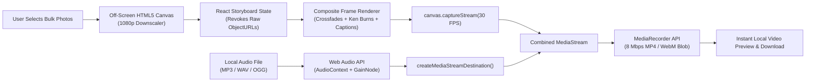

<div align="center">

# 🎬 MemoryReel

### Zero-Server Storyboard & Slideshow Video Creator

[](https://memory-reel.github.io)
[](https://astro.build)
[](https://react.dev)
[](https://tailwindcss.com)
[](https://memory-reel.github.io)
[](https://buymeacoffee.com/kisharadilz)

**MemoryReel** is a 100% client-side web application that transforms personal photos and audio tracks into high-definition **1080p MP4/WebM video slideshows** directly inside the browser. Built with **Astro** and **React Islands**, all media optimization, storyboard sequencing, crossfade rendering, and audio mixing occur locally on the user's device—**zero server uploads, zero cloud queues, and total privacy.**

[Explore Live Studio](https://memory-reel.github.io) · [Report an Issue](https://github.com/memory-reel/memory-reel.github.io/issues) · [Support the Developer](https://buymeacoffee.com/kisharadilz)

</div>

---

## ✨ Key Features

- **🔒 100% Zero-Server Privacy:** Photos, audio tracks, and rendered videos never leave the user's browser.
- **⚡ Off-Screen 1080p Canvas Optimizer:** Automatically downscales heavy 4K/8K raw camera images into a standardized `1920×1080` bounding box using an off-screen HTML5 `<canvas>` (`ctx.drawImage`) prior to state storage, preventing browser RAM exhaustion and tab crashes.
- **🎞️ Adaptive Sortable Storyboard:**
  - **Desktop (`lg+`):** Expansive horizontal drag-and-drop filmstrip timeline.
  - **Tablet & Mobile (`< lg`):** Touch-friendly vertical sortable list with accessible reorder controls and per-slide duration steppers.
- **🎥 Real-Time Canvas & MediaRecorder Engine:**
  - Smooth cosine crossfade transitions (`0.4s`, `0.8s`, `1.2s`).
  - Optional **Ken Burns** pan & zoom motion (`zoom-in`, `zoom-out`, `pan-left`, `pan-right`).
  - Dual framing modes: **Fit + Blurred Backdrop** (ideal for portrait photos in landscape videos) and **Cinema Cover Fill**.
  - Aspect ratio presets: **16:9 Landscape** (`1920×1080`), **9:16 Vertical Reel** (`1080×1920`), and **1:1 Square** (`1080×1080`).
  - Per-slide custom caption overlays.
- **🎵 Web Audio API Mixing & Built-In Ambient Synth:**
  - Attach local `MP3`, `WAV`, `OGG`, or `M4A` audio tracks with automatic fade-in/fade-out.
  - Includes a procedural stereo WAV ambient soundtrack generator so users can test full audio-video stitching with a single click.
- **🌍 Multilingual & Technical SEO Ready (7 Languages):**
  - Static subpath localization for **English (`/` & `/en/`)**, **Español (`/es/`)**, **Português (`/pt/`)**, **Deutsch (`/de/`)**, **Français (`/fr/`)**, **日本語 (`/ja/`)**, and **简体中文 (`/zh/`)**.
  - Complete `hreflang` alternate links, OpenGraph/Twitter metadata, `sitemap.xml`, and `SoftwareApplication` JSON-LD structured data.

---

## 🏗️ System Architecture & Media Pipeline



---

## 🎨 Design System & Color Palette

MemoryReel is crafted around a cohesive coastal-cinema palette supporting both **Light Mode** (default) and **Dark Mode**:

| Color Role | Hex | Preview | Usage |
| :--- | :--- | :--- | :--- |
| **Deep Ocean Blue** | `#086288` |  | Primary actions, brand headings, active controls, video caption pills |
| **Cerulean Blue** | `#4D8DBA` |  | Secondary interactive elements, borders, hover states, gradients |
| **Soft Sky Blue** | `#97D7FF` |  | Surface tints, dropzone highlights, dark-mode glowing accents |
| **Warm Cream** | `#FFEFC4` |  | High-contrast CTA accents, badges, icon highlights, caption typography |

---

## 📂 Project Structure

```text
memory-reel.github.io/
├── .github/
│   └── workflows/
│       └── deploy.yml             # Automated GitHub Pages CI/CD pipeline
├── public/
│   ├── favicon.svg                # Branded cinema-reel vector icon
│   ├── robots.txt                 # Search crawler directives
│   └── sitemap.xml                # Multilingual XML sitemap with hreflang links
├── src/
│   ├── components/
│   │   ├── AppPage.astro          # Unified page template (Hero, Studio, SEO & FAQ)
│   │   ├── MediaUploader.tsx      # React Island: Bulk photo dropzone & 1080p compression UI
│   │   ├── Navbar.astro           # Sticky navbar (strict icon-only layout on mobile/tablet)
│   │   └── Storyboard.tsx         # React Island: Sortable timeline, live preview & export studio
│   ├── i18n/
│   │   └── translations.ts        # Full localization dictionaries (en, es, pt, de, fr, ja, zh)
│   ├── layouts/
│   │   └── Layout.astro           # Document shell, SEO meta, JSON-LD, gtag.js & theme script
│   ├── pages/
│   │   ├── [lang]/
│   │   │   └── index.astro        # Localized static routes (/en/, /es/, /pt/, /de/, /fr/, /ja/, /zh/)
│   │   └── index.astro            # Default root route (/)
│   ├── styles/
│   │   └── global.css             # Tailwind directives, custom scrollbars & card surfaces
│   └── utils/
│       ├── imageCompressor.ts     # Off-screen 1080p Canvas downscaler & demo media generator
│       └── VideoRenderer.ts       # Canvas frame compositor, Web Audio mixer & MediaRecorder engine
├── astro.config.mjs               # Astro SSG, React, Tailwind & i18n configuration
├── tailwind.config.mjs            # Custom color tokens, typography & dark mode configuration
├── tsconfig.json                  # Strict TypeScript configuration
└── package.json                   # Project dependencies and build scripts
```

---

## 🚀 Getting Started

### Prerequisites

- **Node.js** `>= 18.17.1` (Node `20+` or `24+` recommended)
- **npm** `>= 9.0.0`

### Installation & Local Development

1. **Clone the repository:**
   ```bash
   git clone https://github.com/memory-reel/memory-reel.github.io.git
   cd memory-reel.github.io
   ```

2. **Install dependencies:**
   ```bash
   npm install
   ```

3. **Start the development server:**
   ```bash
   npm run dev
   ```
   Open `http://localhost:4321` in your browser.

4. **Build for production:**
   ```bash
   npm run build
   ```
   Static assets are generated in the `./dist` directory.

5. **Preview the production build locally:**
   ```bash
   npm run preview
   ```

---

## 🌐 Internationalization (i18n) & SEO

MemoryReel pre-renders localized static entrypoints for all 7 supported languages during `astro build`:

| Code | Flag / Label | Language Name | Static Route | Target SEO Keywords |
| :---: | :---: | :--- | :--- | :--- |
| `en` | 🇺🇸 `US` | **English** | `/` & `/en/` | `free online slideshow maker`, `photo to video browser tool`, `zero server slideshow creator`, `private photo reel maker` |
| `es` | 🇪🇸 `ES` | **Español** | `/es/` | `creador de diapositivas gratis`, `convertir fotos a video online` |
| `pt` | 🇧🇷 `BR` | **Português** | `/pt/` | `criador de slideshow grátis`, `transformar fotos em vídeo online` |
| `de` | 🇩🇪 `DE` | **Deutsch** | `/de/` | `Diashow kostenlos erstellen`, `Fotos zu Video Browser Tool` |
| `fr` | 🇫🇷 `FR` | **Français** | `/fr/` | `créateur de diaporama gratuit`, `convertir photo en vidéo` |
| `ja` | 🇯🇵 `JP` | **日本語** | `/ja/` | `スライドショー 作成 無料`, `写真 動画 変換 ブラウザ` |
| `zh` | 🇨🇳 `CN` | **简体中文** | `/zh/` | `免费在线幻灯片制作`, `照片合成视频工具`, `浏览器本地视频生成` |

---

## 🧩 Browser Compatibility

MemoryReel relies on standard modern Web APIs (`HTMLCanvasElement.captureStream`, `MediaRecorder`, and `AudioContext`):

- **Google Chrome / Microsoft Edge / Brave / Opera:** Full support (`MP4 / H.264` or `WebM / VP9` with Opus audio).
- **Mozilla Firefox:** Full support (`WebM / VP8` with Opus audio).
- **Apple Safari (macOS & iOS 14.5+):** Full support (`MP4 / H.264` with AAC audio).

---

## ☕ Support the Developer

If you find **MemoryReel** helpful for creating private, zero-server photo slideshows, consider supporting ongoing development:

<a href="https://buymeacoffee.com/kisharadilz" target="_blank" rel="noopener noreferrer">
  
</a>

---

## 📄 License

Distributed under the **MIT License**. See [LICENSE](./LICENSE) for full details.
